# Horizon Atlas · Lunar Landing Site Navigator
**NASA Space Apps Challenge 2026 · Team VOIDBRONE**

<p align="center">
  
</p>

Horizon Atlas is an interactive mission-planning and educational web tool designed to evaluate solar power availability (illumination percentage) and direct Earth communication line-of-sight for lunar south pole landing sites. It replaces simplified models with authentic NASA open data:

1. **Astronomical Ephemerides**: Apparent hourly azimuth and elevation for the Sun (Body 10) and Earth (Body 399) from the **NASA/JPL Horizons API** (`CENTER='coord@301'`).
2. **Topographic Horizon Profiles**: 360° radial terrain masks ray-marched outward to 30 km from the **NASA LRO LOLA 80 m DEM** (`LDEM_80S_80MPP_ADJ.TIF`), rigorously accounting for lunar sphericity curvature drop ($\Delta z = d^2 / (2R)$).

---

## Artemis III Candidate Landing Sites

| Site | Latitude | Longitude | Ground Elevation | NASA Reference |
| :--- | :--- | :--- | :--- | :--- |
| **Connecting Ridge (Site 01)** | -89.46°S | 222.51°E | +1,935.6 m | NASA PGDA Product 78 / Barker et al. (2021) |
| **Peak Near Shackleton (Site 07)** | -88.81°S | 123.69°E | +1,647.6 m | NASA PGDA Product 78 / Barker et al. (2021) |
| **Malapert Massif** | -85.99°S | 357.07°E | +4,843.3 m | NASA Artemis III Candidate Regions / USGS LGRS |
| **Haworth** | -87.45°S | 354.83°E | -3,312.3 m | NASA Artemis III Candidate Regions / IAU Gazetteer |

Validation, data sources, method, credits, strengths and users: method.html

---

## Quickstart: Running Locally

Because Horizon Atlas uses asynchronous `fetch()` to load authentic NASA JSON datasets (`data/*.json`), web browsers block local file reading via the `file://` protocol due to CORS security policies.

To run the application locally:

```bash
# Start a lightweight static web server in the repository root
python -m http.server 8000
```

Then open your browser to:
**[http://localhost:8000](http://localhost:8000)**

---

## Data Pipeline & Precomputation

The web application runs entirely as a static frontend without build tools or runtime server dependencies. Heavy datasets are precomputed and stored in `data/`:

### 1. Fetching Ephemerides from NASA/JPL Horizons
Queries the Horizons API in 90-day chunks across 13 months (2026-12-01 to 2027-12-31, 9,481 hourly points per site):
```bash
python fetch_horizons.py
```
Output: `data/connecting_ridge.json`, `data/peak_near_shackleton.json`, `data/malapert_massif.json`, `data/haworth.json`, and `data/index.json`.

### 2. Generating LOLA Topographic Horizon Masks
Samples the 80 m LOLA Digital Elevation Model (`data/raw/LDEM_80S_80MPP_ADJ.TIF`) along 360 azimuth rays up to 30 km:
```bash
python data_pipeline/build_horizon_profile.py
```
Output: `data/horizon_<site_id>.json` containing 360-degree horizon elevation masks.

---

## Model Assumptions & Limitations

<p align="center">
  
</p>

- **Topography**: Computed from the official LRO LOLA 80 m/pixel south polar DEM. Sub-pixel boulders and micro-topography below 80 m are smoothed.
- **Observer Height**: Modeled at ground level (0 m above terrain). A mast or lander solar panel mounted several meters high would experience slightly reduced blockage.
- **Lunar Curvature**: Incorporates lunar surface sphericity drop ($\Delta z = d^2 / (2R)$, $R = 1737.4\text{ km}$).
- **Disk Centers**: Solar and Earth visibility are evaluated from apparent disk centers (solar semi-diameter ~0.26°, Earth semi-diameter ~0.95°).
- **Science Score**: Clearly disclosed in the interface as an illustrative placeholder until permanently shadowed region (PSR) volatile distribution data is integrated.

---

## Team Members · Team VOIDBRONE

| Name | Role | GitHub Profile |
| :--- | :--- | :--- |
| **Sudipto Acharjee Dhrubo** | Team Lead | [@Sudipto-Acharjee-Dhrubo](https://github.com/Sudipto-Acharjee-Dhrubo) |
| **Rafia Haque Arpita** | Team Member | [@rafia-haque-arpita](https://github.com/rafia-haque-arpita) |
| **Md Asiful Islam** | Team Member | [@Asiful030](https://github.com/Asiful030) |
| **Md Sabik Anjum** | Team Member | [@Shudddhoo](https://github.com/Shudddhoo) |
| **Navid Rehman** | Team Member | — |

---

## Documentation

- [`docs/DATA_SOURCES.md`](docs/DATA_SOURCES.md): Full NASA open data source registry, endpoints, and coordinate citations.
- [`AI_USAGE.md`](AI_USAGE.md): Complete AI disclosure log in accordance with NASA Space Apps Challenge regulations.

